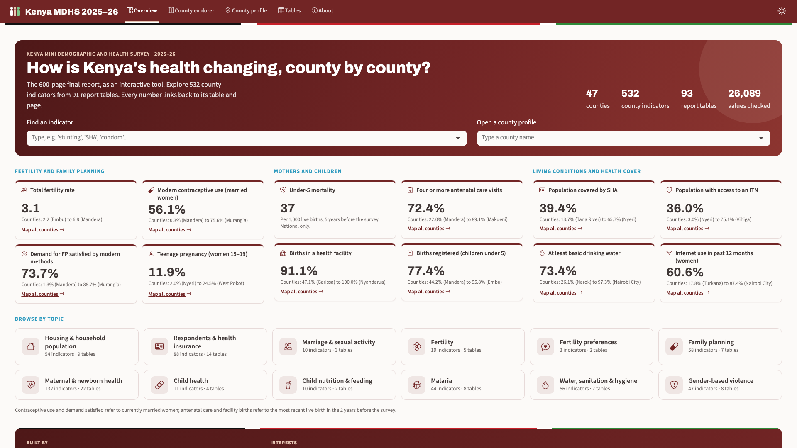
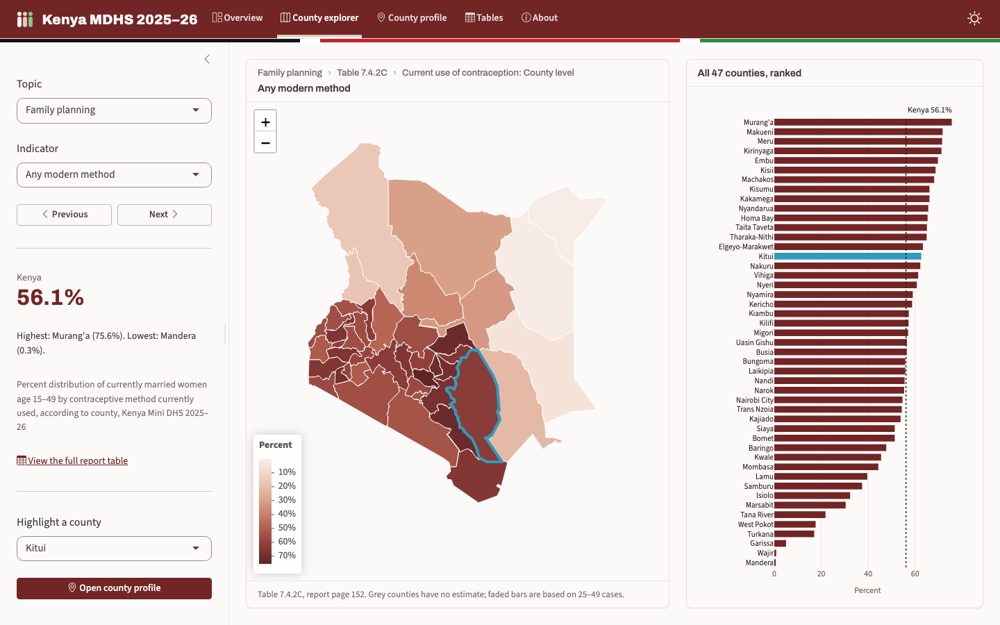
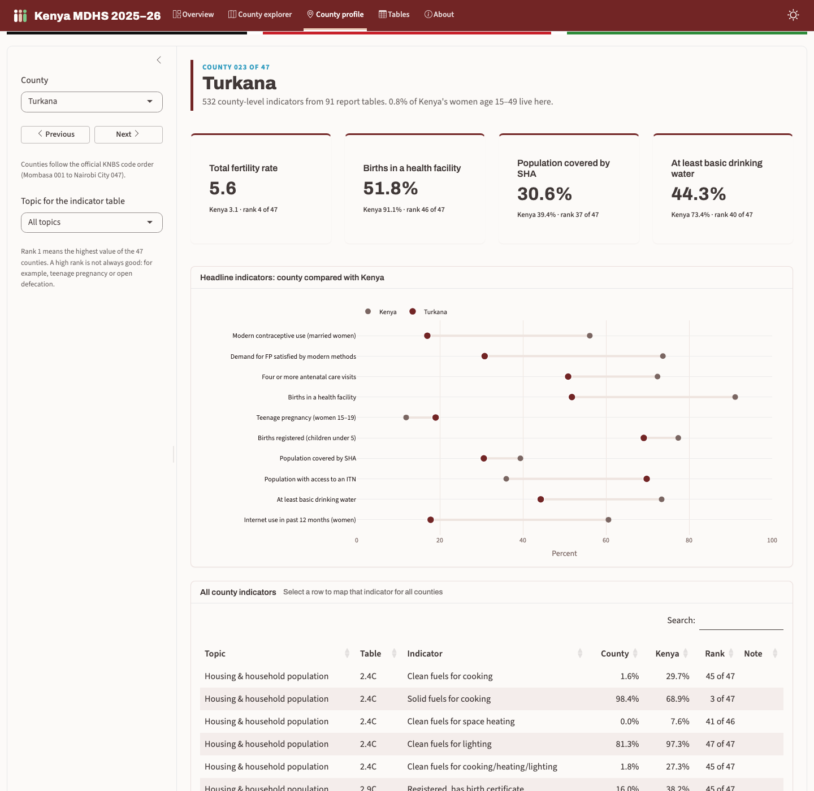
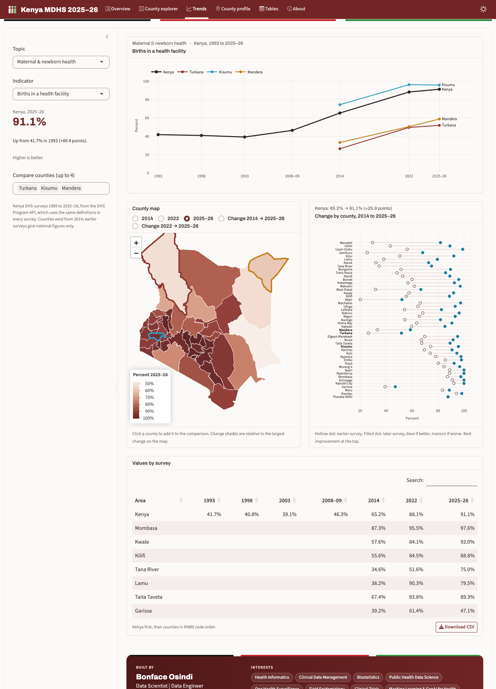

# Kenya MDHS 2025–26 Dashboard

An interactive R Shiny dashboard built from the **2025–26 Kenya Mini Demographic and Health Survey (KMDHS)**
final report. It turns a 644-page PDF into a tool you can search, map and compare, county by county.

**Live dashboard:** https://bonfaceosindi.github.io/kenya-mdhs-dashboard/
(it runs entirely in your browser through Shinylive; the first load takes 30–60 seconds while R starts up)



---

## Why I built this

The KMDHS is Kenya's most recent nationally representative source on fertility, family planning,
maternal and newborn health, child health and nutrition, malaria, water and sanitation, health insurance
under the new Social Health Authority (SHA), and technology-facilitated gender-based violence. Its great
strength is that it reports estimates for **all 47 counties**, the level at which Kenya's health services
are planned and funded under devolution.

That strength is also hard to use. The final report runs to more than 600 pages and over 90 county tables.
A county health officer preparing a budget, a journalist checking a claim, a student, or a programme
manager who wants one number, or wants to see how their county compares, has to search through
hundreds of pages and read across wide tables by eye.

I wanted to close that gap between **data that exists** and **data that people can use**. This
project is a small example of the health information systems work I care about:

- **Make evidence easy to reach.** Two clicks from any headline figure to a map of all 47 counties.
- **Keep it traceable.** Every number shows the report table and page it came from, so it can be checked.
- **Be honest about uncertainty.** Estimates based on few cases are flagged, suppressed values stay
  hidden, and the app warns that county differences are often within sampling error.
- **Keep it cheap to run and easy to reuse.** Open source, free to host, and a reproducible pipeline
  from PDF to dashboard.

It is also a portfolio project in health data science: PDF data extraction, validation, data
engineering, interactive visualisation and deployment, end to end.

---

## What you can do with it

| Tab | What it gives you |
|---|---|
| **Overview** | Twelve headline indicators (fertility, contraception, antenatal care, facility births, SHA coverage, ITN access, water, internet use and more), each with the national figure, the county range and the change since the 2022 survey. Quick search across all 532 county indicators, and topic cards to browse. |
| **County explorer** | Pick any of the 532 county-level indicators: a choropleth map of Kenya and a ranked bar chart of all 47 counties, with the national value marked. Click a county to highlight it. Step through indicators with Previous / Next. |
| **Trends** | 31 indicators across every Kenya DHS since 1989: Kenya's line over time with up to four counties overlaid, a county map you can filter by survey year (2014, 2022, 2025–26) or switch to show change between years, a chart ranking counties by how much they improved, and a downloadable table. |
| **County profile** | A one-page profile for any county: headline tiles with rank, a county-versus-Kenya comparison chart, small charts of how the county has changed since 2014, and a searchable table of every indicator. Select a row to map that indicator. |
| **Tables** | Every extracted report table, searchable, filterable by topic and downloadable as CSV, laid out like the report. |
| **About** | Motivation, method, how to read the numbers, and the source and licence. |

Every view has a shareable link, for example `?tab=profile&county=Kisumu` opens Kisumu's profile.
There is a light and a dark theme. Colours follow the report: the cover's maroon, its teal-blue headings
and the Kenyan flag.

| County explorer | County profile |
|---|---|
|  |  |



---

## How it was made

```
Report PDF ──► extract/extract_tables.R ──► app/data/kmdhs.rds ─┐
                 └─ extract/table_registry.csv                     ├─► app/ (Shiny) ──► Docker or GitHub Pages
DHS Program API ──► extract/fetch_trends.R ──► app/data/trends.rds ─┘
                 └─ extract/trend_indicators.csv  (cross-checked against kmdhs.rds)
```

### 1. Extraction (`extract/extract_tables.R`)

DHS reports are text PDFs, so the script reads the text layer with **pdftools** (layout preserved)
instead of using OCR.

1. Each table is found by its title line (`Table 7.4.2C ...`), and its block is cut out, including
   tables that continue onto the next page.
2. Data rows are parsed as *a label followed by exactly n values*, where n is the number of columns.
   The parser tracks panel banners (for example `LIVE BIRTHS`), group headings, labels that wrap onto a
   second line, and value lines that spill onto their own line.
3. Column names come from a **hand-reviewed registry** (`extract/table_registry.csv`), not from
   automatic guessing. Multi-line DHS column headers are too irregular to parse reliably. The
   script can draft registry rows (`--draft`), but each one is checked against the PDF before it is
   marked `reviewed = TRUE`.
4. DHS conventions are kept as flags rather than lost: values in brackets (25–49 unweighted cases),
   `*` (suppressed, fewer than 25 cases), `na` / `-` (not applicable), `a` (not calculated) and `<0.1`.
5. County names are standardised, and each indicator is linked to its denominator column.

### 2. Validation

The build **stops without writing any data** if a check fails. The checks are:

- every county table lists all 47 counties (two rows missing from the report itself are documented),
- each table has unique row and column keys,
- percentage distributions add up to 100 (within rounding),
- the county tables' Kenya totals match the national tables.

The latest build passes all 319 automated checks (`extract/qa_report.csv`). A further 35 randomly
sampled values were checked by hand against the PDF and all match (`extract/qa_log.csv`).

### 3. Trends across surveys (`extract/fetch_trends.R`)

Earlier surveys come from the **DHS Program API**, which publishes every Kenya DHS (1989, 1993, 1998,
2003, 2008–09, 2014, 2022 and 2025–26) with the same indicator definitions in each one. This
avoids parsing older reports, whose tables are laid out differently.

- `extract/trend_indicators.csv` is a curated list of 31 indicators with labels, topics, units,
  whether higher is better, and the matching 2025–26 report indicator.
- Counties exist from 2014. Earlier surveys report national (and former province) figures only.
  Mortality rates are kept national only, because their county versions use a 10-year period.
- Where the API does not yet have a 2025–26 value (water, sanitation, birth registration), it is
  taken from the report extraction.
- **Independent cross-check:** where both sources have 2025–26 values, the API's figures were compared
  with the PDF extraction. All **720 values** across 15 indicators (47 counties plus Kenya) match
  exactly (`extract/trend_crosscheck.csv`). The build stops if any disagree.

Definitions that changed between surveys are not forced into a trend. For example, SHA coverage has
no earlier equivalent, and stunting and vaccination were not measured in the 2025–26 Mini DHS.

### 4. The data

| | |
|---|---|
| Report tables extracted | 93 (91 county-level tables plus national tables) |
| Values | 26,089 |
| County-level indicators | 532 |
| Topics | 12 |
| Trend indicators | 31, across 8 surveys from 1989 to 2025–26 (4,655 values) |

The tidy dataset (`app/data/kmdhs.rds`) has one row per value: table, topic, title, page, panel,
group, category, indicator, value, flag, denominator (n) and unit. County boundaries come from
**geoBoundaries** (gbOpen, KEN ADM1, CC BY 4.0) and are stored as plain coordinates, so the app does
not need `sf` at runtime.

### 5. The app (`app/`)

- **R Shiny** with **bslib** (Bootstrap 5), **leaflet** for the map, **plotly** for the charts and **DT**
  for the tables.
- `ui.R` holds layout only, `server.R` holds the reactive logic, and `global.R` loads the data and
  helpers once per session.
- For speed, the map is recoloured through `leafletProxy` instead of being redrawn, the charts are
  cached with `bindCache`, and all data is prebuilt, so nothing is parsed at runtime.
- Charts follow accessible design practice: one sequential colour ramp for the map, a single
  contrasting highlight, values never shown by colour alone, and hover details with sample sizes
  and flags.

---

## Project structure

```
.
├── app/                        # the Shiny app (this is all that is deployed)
│   ├── global.R                # packages, data, palette, helpers, author details
│   ├── ui.R                    # layout and styling
│   ├── server.R                # reactive logic
│   ├── about.md                # the About tab
│   └── data/                   # prebuilt by the extraction script
│       ├── kmdhs.rds           # tidy values (26,089 rows)
│       ├── trends.rds          # 1989–2025–26 series (4,655 rows)
│       ├── catalog.csv         # one row per report table
│       └── counties.rds        # county boundaries
├── extract/
│   ├── extract_tables.R        # PDF -> tidy data, with validation
│   ├── table_registry.csv      # hand-checked column names for each table
│   ├── qa_report.csv           # automated validation results
│   ├── qa_log.csv              # manual spot checks against the PDF
│   ├── fetch_trends.R          # DHS Program API -> trends, with cross-check
│   ├── trend_indicators.csv    # the 31 trend indicators and their report matches
│   └── trend_crosscheck.csv    # API vs report, 2025–26 (720 values, all match)
├── screenshots/                # images used in this README
├── .github/workflows/deploy.yml  # builds and publishes the GitHub Pages site
└── Dockerfile                  # runs the app in a container
```

---

## Running it

### In the browser (no install)

Open the [live dashboard](https://bonfaceosindi.github.io/kenya-mdhs-dashboard/).

### Locally with R

Requires R 4.3 or later.

```r
install.packages(c("shiny", "bslib", "bsicons", "dplyr", "tidyr", "leaflet", "plotly", "DT"))
shiny::runApp("app")
```

### With Docker

```bash
docker build -t kmdhs-dashboard .
docker run -d --name kmdhs -p 4949:4949 kmdhs-dashboard
# open http://localhost:4949
```

### Rebuilding the data from the PDF

The report PDF is not stored in this repository. Download the *2025–26 Kenya Mini DHS Final Report*
from [The DHS Program](https://dhsprogram.com) (search for Kenya) or the
[Kenya National Bureau of Statistics](https://www.knbs.or.ke), and save it as
`KMDHS_2025-26_Final_Report/KMDHS_2025-26_Final_Report.pdf`. Then, from the project root:

```bash
Rscript extract/extract_tables.R                    # rebuild app/data/ from the registry
Rscript extract/extract_tables.R --draft 2.4C 3.9C  # draft registry rows for new tables
Rscript extract/extract_tables.R --draft-county     # draft every county table not yet registered
```

Extraction needs `pdftools`, `dplyr`, `tidyr`, `stringr`, `purrr` and `readr`. To rebuild the
county boundaries once, it also needs `sf` and `jsonlite`.

To refresh the multi-year trends (needs internet access and `jsonlite`; run after the extraction,
because it cross-checks against `app/data/kmdhs.rds`):

```bash
Rscript extract/fetch_trends.R
```

### Deployment

Every push to `main` triggers `.github/workflows/deploy.yml`. The workflow exports `app/` with
[Shinylive](https://posit-dev.github.io/r-shinylive/), which turns it into a static site that runs R
in the browser through WebAssembly (webR), and publishes the result to GitHub Pages. No server is needed.

---

## Reading the numbers responsibly

- Values marked as based on **25–49 unweighted cases** are shown faded or in brackets. Treat them
  with caution.
- **Suppressed** values (fewer than 25 cases) are not shown.
- County estimates rest on small samples. Differences between counties are often within sampling
  error, so a ranking is not a league table.
- Rank 1 means the **highest** value, which is not always the best (for example, teenage pregnancy).
- Known gaps in the report itself are recorded in the registry. The Wajir row is missing from Table 3.8C,
  and the Mombasa row in Table 7.14.2C is blank in the PDF.

---

## Source and licence

**Data source:** KNBS and ICF. 2026. *2025–26 Kenya Mini Demographic and Health Survey.* Nairobi, Kenya,
and Rockville, Maryland, USA: KNBS and ICF. ISBN 978-9914-9428-7-3. Available from
[dhsprogram.com](https://dhsprogram.com) and [knbs.or.ke](https://www.knbs.or.ke).

The report also prints the DOI 10.63814/k7m3xq21, which did not yet resolve at doi.org as of
November 2026.

The report is published under **CC BY-NC 4.0**. This dashboard is a non-commercial derivative. It is
not an official product of KNBS, the Ministry of Health or ICF, and its values come from the
published tables, not the survey microdata.

Trends across surveys: The DHS Program API (ICF), Kenya DHS 1989 to 2025–26,
[api.dhsprogram.com](https://api.dhsprogram.com).

County boundaries: geoBoundaries, gbOpen KEN ADM1, CC BY 4.0.

---

## Author

**Bonface Osindi**, Data Scientist | Data Engineer
Email: bonfaceosindi@gmail.com · GitHub: [@bonfaceosindi](https://github.com/bonfaceosindi)

Interests: health informatics, clinical data management, biostatistics, public health data science,
One Health surveillance, field epidemiology, clinical trials, machine learning and GenAI for health,
data engineering, cloud computing, health dashboards and data visualisation, research and publishing,
and mentoring in data science.
